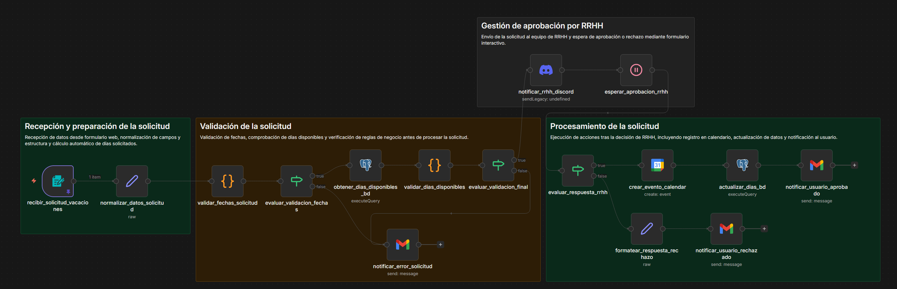
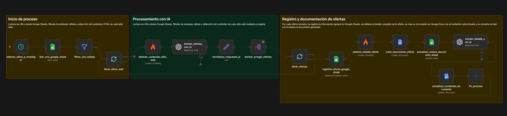
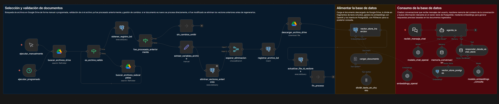

# n8n Automation Workflows

[English](README.md) · **Español**

## Descripción general

Este repositorio reúne una colección de flujos de automatización hechos con **n8n**, pensados para resolver problemas reales de negocio mediante la automatización de procesos.

Cada flujo es una solución independiente y cubre un caso de uso distinto: gestión de solicitudes, web scraping, extracción de datos con IA y toma de decisiones automática.

---

## Flujos incluidos

### 1. Sistema de solicitud de vacaciones y bajas por enfermedad

Automatiza la gestión de las solicitudes de ausencia de los empleados, incluida la validación, la aprobación por parte de RR. HH. y el procesamiento automático.

#### Funciones principales:

- Envío de solicitudes mediante formulario  
- Validación de las reglas de negocio  
- Soporte para vacaciones y bajas por enfermedad  
- Aprobación de RR. HH. a través de Discord  
- Integración con Google Calendar  
- Actualización de la base de datos  
- Notificaciones por correo electrónico  

**Ruta:** `vacation-request-system/`

---

### 2. Sistema de scraping de ofertas de empleo

Automatiza el scraping diario de portales de empleo tecnológico, extrae con IA los datos de cada oferta de forma estructurada y guarda los resultados en Google Sheets, con un documento de Google Docs detallado por oferta.

#### Funciones principales:

- Ejecución diaria programada  
- Scraping de varios portales con Firecrawl  
- Extracción de datos con IA mediante OpenAI  
- Integración con Google Sheets  
- Generación automática de un documento de Google Docs por oferta  

**Ruta:** `job-scraping-system/`

---

### 3. Sistema RAG estándar

Un pipeline de Retrieval-Augmented Generation listo para producción que importa documentos desde Google Drive, vectoriza su contenido con embeddings de OpenAI y los guarda en PostgreSQL con PGVector. Incluye un agente conversacional de IA que responde preguntas basándose únicamente en los documentos importados.

#### Funciones principales:

- Importación de documentos manual y programada  
- Detección de cambios para no volver a procesar ficheros que no han cambiado  
- División de documentos en fragmentos y generación de embeddings  
- Almacenamiento vectorial con PostgreSQL y PGVector  
- Agente conversacional de IA con memoria de sesión  
- Adaptable a cualquier dominio mediante el prompt de sistema  

**Ruta:** `rag-document-system/`

---

## Tecnologías utilizadas

- n8n  
- OpenAI API  
- Firecrawl  
- Google Sheets y Google Docs  
- Google Drive  
- PostgreSQL + PGVector  
- Google Calendar API  
- Discord  
- Servicios de correo electrónico  

---

## Estructura del proyecto

    n8n-automation-workflows/
    ├── vacation-request-system/
    ├── job-scraping-system/
    └── rag-document-system/

Cada carpeta contiene:

- `workflow.json` → el flujo de n8n  
- `README.md` / `README.es.md` → explicación de la solución (inglés / español)  
- `images/` → capturas del flujo  

---

## Requisitos de configuración

Para ejecutar cualquier flujo tienes que configurar tus propias credenciales:

- Conexión a la base de datos (PostgreSQL)  
- Google Calendar  
- Google Drive (OAuth2)  
- Discord  
- Servicio de correo electrónico  
- Clave de la API de OpenAI  
- Clave de la API de Firecrawl  
- Google Sheets y Google Docs (OAuth2)  

Por seguridad, las credenciales no se incluyen en el repositorio.

---

## Cómo usarlo

1. Importa en n8n el flujo que quieras  
2. Configura las credenciales necesarias  
3. Ajusta los valores propios de tu entorno si hace falta  
4. Ejecuta el flujo  

---

## Objetivo

Este repositorio nace de la práctica con n8n y se centra en construir soluciones de automatización prácticas que simulan escenarios reales.

---

## Notas

- Los flujos son modulares y se pueden adaptar a distintos entornos  
- Los nombres internos de los nodos pueden estar en español; la documentación está en inglés y en español  
- El objetivo es mostrar el diseño de la automatización, no solo la implementación técnica
